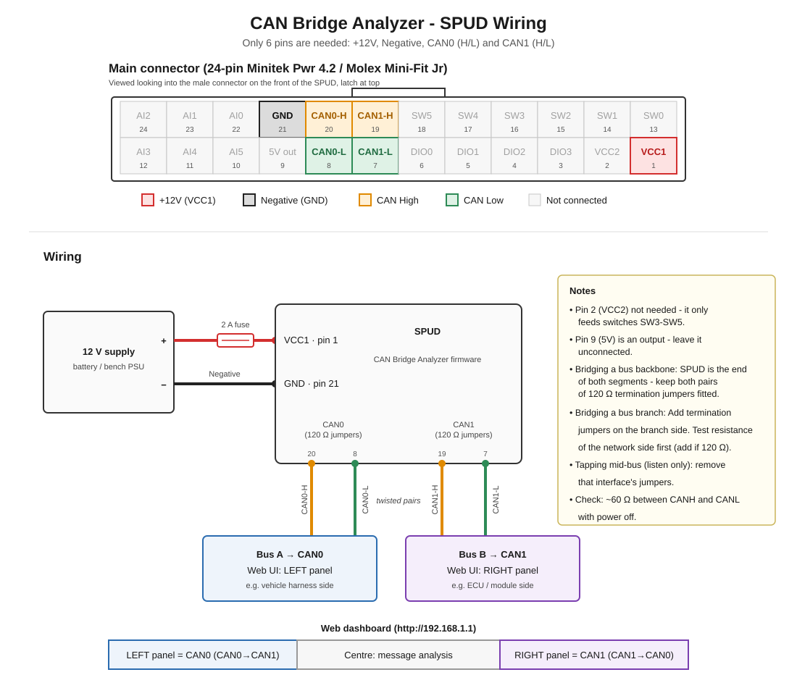

# CAN Bridge Analyzer

**v0.3.0** · [Changelog](CHANGELOG.md)

A dual-bus CAN 2.0 / CAN FD capture, analysis, and bridging tool for the **SPUD** DIY controller board by [Ripple Tech](https://shop.rippletech.co.nz).

Flash it once and configure everything over WiFi — no re-flashing required to change bus speed, mode, or SSID.

---

## Hardware

This firmware is designed for the **SPUD** board from [Ripple Tech](https://shop.rippletech.co.nz), which features:

- ESP32 microcontroller
- Two MCP251863 CAN FD controllers connected via SPI
- 40 MHz oscillator for each CAN controller
- Dual isolated CAN transceivers (CANH / CANL)

Two CAN controller chips are supported, each with its own build environment
(see [Building](#building)):

| Controller | Build environment | Oscillator | Protocols |
|------------|-------------------|------------|-----------|
| **MCP251863** (SPUD, default) | `can-bridge-analyzer-mcp251863` | 40 MHz | CAN 2.0 and CAN FD |
| **MCP2515** (classic CAN boards) | `can-bridge-analyzer-mcp2515` | 8 MHz | CAN 2.0 only |

> The SPUD board is available from [shop.rippletech.co.nz](https://shop.rippletech.co.nz)

---

## Features

- **Dual-bus CAN capture** — monitor CAN0 and/or CAN1 simultaneously
- **CAN 2.0B and CAN FD** — select bus speed and frame type at runtime
- **WiFi web interface** — real-time dashboard at `http://192.168.1.1`
- **SavvyCAN compatible** — serial output in CSV or binary GVRET format
- **CAN bridge mode** — bidirectional message forwarding between CAN0 and CAN1
- **Per-ID filtering** — block individual CAN IDs from forwarding via the web UI
- **Bus health diagnostics** — detailed error counter reporting with actionable guidance
- **NVS configuration** — all settings persist across reboots

---

## Getting Started

### 1. Flash the firmware

```bash
# Install PlatformIO then:
pio run --target upload
```

### 2. Connect to WiFi

After booting, the device creates a WiFi access point:

| Setting  | Default             |
|----------|---------------------|
| SSID     | `CanBridgeAnalyzer` |
| Password | `canbus123`         |

Connect your phone or laptop to this network.

### 3. Open the web interface

Navigate to **http://192.168.1.1** in any browser.

### 4. Configure the device

Go to **http://192.168.1.1/config** to set:

- CAN bus enable (CAN0, CAN1, or both)
- Bus speed and frame type (125k–1M CAN 2.0 or CAN FD up to 8 Mbps data rate)
- Serial output mode (diagnostics / SavvyCAN CSV / binary GVRET)
- WiFi SSID and password

Changes are saved to flash and take effect after reboot.

---

## Over-the-Air Updates

After the first USB flash, firmware and the DBC filesystem can be updated over
WiFi using [CustomOTA](https://github.com/boydsta/CustomOTA-ESP32).

1. Connect to the device's WiFi and open **http://192.168.1.1/update** (or the
   **OTA** button on the dashboard).
2. Upload `.pio/build/<env>/firmware.bin` for firmware, or
   `.pio/build/<env>/spiffs.bin` (from `pio run -e <env> -t buildfs`) for the
   DBC files.
3. The device restarts on the new firmware. The previous firmware is kept and
   can be restored with **Rollback**.

The flash layout is set by [`partitions.csv`](partitions.csv): two 1.625 MB
firmware slots and 704 KB of SPIFFS for DBC files.

A filesystem upload replaces all files in SPIFFS, including any DBC files
uploaded through the web UI.

**Updates are locked out while CAN traffic is flowing**, because the restart
would interrupt the bridge. The OTA page greys out and shows the reason until
no frames have been received on either bus for 3 seconds (e.g. vehicle off or
CAN disconnected). An upload already in progress is aborted if traffic starts,
and the running firmware is left unchanged.

---

## Serial Logging

Connect a USB serial monitor at **115200 baud**.

| Mode | Description |
|------|-------------|
| 0 — Diagnostics | Bus health, error counters, performance stats |
| 1 — SavvyCAN CSV | Save output to `.csv` and import via *File → Load Log File → GVRET Logs* |
| 2 — Binary GVRET | Live connection in SavvyCAN via *Add New Device → GVRET Serial* |

Toggle serial logging on/off from the web UI without rebooting.

---

## CAN Bus Wiring



| Signal | SPUD Pin (24-pin main connector) | Web UI |
|--------|----------------------------------|--------|
| +12V (VCC1) | 1 | – |
| Negative (GND) | 21 | – |
| CAN0-H / CAN0-L | 20 / 8 | Left panel |
| CAN1-H / CAN1-L | 19 / 7 | Right panel |

- Each CAN interface has 120 Ω termination jumpers. Keep them fitted when the SPUD is at the end of a bus (e.g. bridging a cut bus); remove them when tapping into the middle of a bus.
- Maximum cable length at 500 kbps ≈ 10 m; at 1 Mbps ≈ 5 m.
- See the [user manual](manual/README.md) for full details.

---

## DBC Files (Nissan Leaf)

DBC files for the Nissan Leaf (EV-CAN, CAR-CAN and QC-CAN) are included in
[`data/`](data/). Upload them to the device's SPIFFS filesystem with:

```bash
pio run -e can-bridge-analyzer-mcp251863 -t uploadfs
```

They are then available at **http://192.168.1.1/dbc**, where you can also upload
your own `.dbc` files over WiFi. Decoded signal names and values are shown in the
web dashboard.

The Leaf DBC files are from [Dala's (dalathegreat) leaf_can_bus_messages](https://github.com/dalathegreat/leaf_can_bus_messages)
project — many thanks to Dala and its contributors for years of Leaf CAN
reverse-engineering. They are licensed under GPL-3.0 (see
[`data/LICENSE-GPL-3.0.txt`](data/LICENSE-GPL-3.0.txt)) and are included unmodified
as separate data files.

---

## Building

Requires [PlatformIO](https://platformio.org/). Dependencies are fetched automatically on first build.

```bash
pio run -e can-bridge-analyzer-mcp251863 # MCP251863 CAN-FD hardware
pio run -e can-bridge-analyzer-mcp2515  # classic CAN MCP2515 hardware
pio run -e can-bridge-analyzer-mcp251863 -t upload
pio device monitor  # open serial monitor
```

The `can-bridge-analyzer-mcp2515` environment targets boards with a classic
MCP2515 CAN controller (8 MHz oscillator). It supports CAN 2.0 only.
The `can-bridge-analyzer-mcp251863` environment targets the MCP251863 CAN-FD
controller on the SPUD board and supports runtime CAN-FD presets.

The ACAN2517FD driver is vendored in [`lib/ACAN2517FD`](lib/ACAN2517FD) with
local ESP32 stability fixes — see [`PATCHES.md`](lib/ACAN2517FD/PATCHES.md).

---

## License

Firmware: MIT — see [LICENSE](LICENSE).

- `lib/ACAN2517FD` — MIT, © Pierre Molinaro (see its `LICENSE`)
- Nissan Leaf DBC files in `data/` — GPL-3.0, from [dalathegreat/leaf_can_bus_messages](https://github.com/dalathegreat/leaf_can_bus_messages)

---

## Links

- SPUD board: [shop.rippletech.co.nz](https://shop.rippletech.co.nz)
- SavvyCAN: [https://www.savvycan.com](https://www.savvycan.com)
- ACAN2517FD library: [github.com/pierremolinaro/ACAN2517FD](https://github.com/pierremolinaro/ACAN2517FD)
- Leaf CAN database: [github.com/dalathegreat/leaf_can_bus_messages](https://github.com/dalathegreat/leaf_can_bus_messages)
