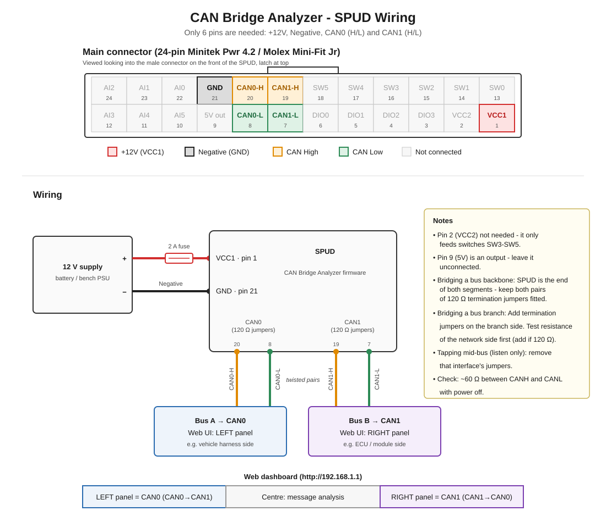

# CAN Bridge Analyzer — User Manual

## 1. Wiring

Only six pins on the SPUD 24-pin main connector are needed:

| Function  | SPUD pin | Signal | Web UI         |
|-----------|----------|--------|----------------|
| +12V      | **1**    | VCC1   | –              |
| Negative  | **21**   | GND    | –              |
| CAN0 High | **20**   | CAN0-H | **Left panel** |
| CAN0 Low  | **8**    | CAN0-L | **Left panel** |
| CAN1 High | **19**   | CAN1-H | **Right panel**|
| CAN1 Low  | **7**    | CAN1-L | **Right panel**|

- Fit a 2 A inline fuse on the +12V lead.
- VCC2 (pin 2) is not required; it only feeds switches SW3–SW5.
- Pin 9 (5V) is an output; leave it unconnected.
- **Termination:** each CAN interface has two jumpers that fit a 120 Ω terminator.
  - When bridging a cut bus, the SPUD is the end of both segments, so keep both
    jumper pairs fitted.
  - When tapping into the middle of an existing bus (listen only), remove that
    interface's jumpers.
  - With power off, measure ~60 Ω between CANH and CANL on each bus.

<!-- TODO: screenshots and step-by-step instructions -->
