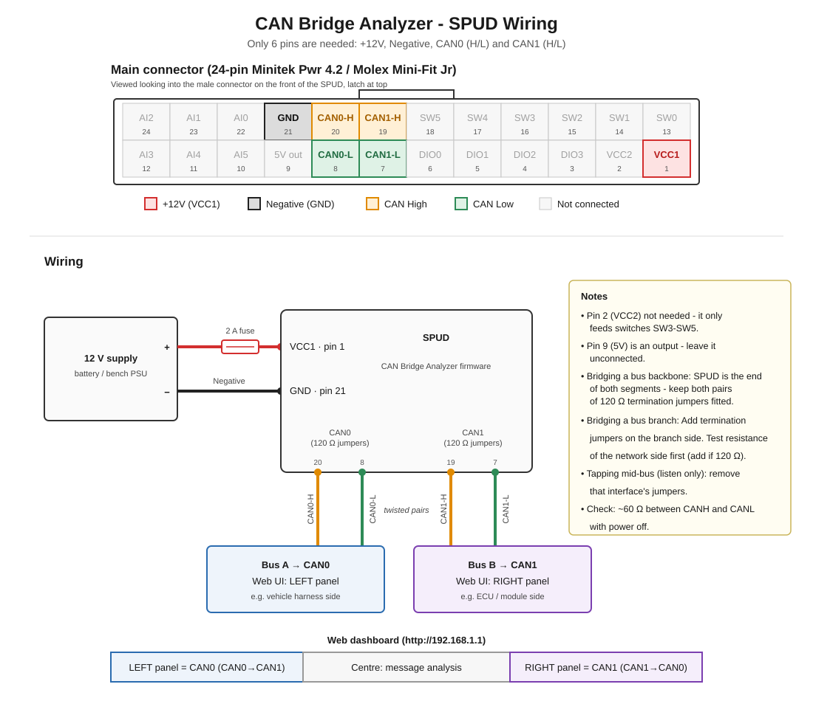

# CAN Bridge Analyzer — Hardware Setup

> **Draft** — firmware v0.3.0 + unreleased WiFi changes. Photos to follow.

This page covers wiring the SPUD, getting it onto the bus, and connecting to it
for the first time. For using the web interface, see [How to use](usage.md).

## Contents

1. [What you need](#1-what-you-need)
2. [Wiring](#2-wiring)
3. [Termination](#3-termination)
4. [Choosing how to connect to the vehicle](#4-choosing-how-to-connect-to-the-vehicle)
5. [First power-up and connection](#5-first-power-up-and-connection)
6. [Installing the firmware (first time only)](#6-installing-the-firmware-first-time-only)
7. [Factory reset](#7-factory-reset)
8. [Pin reference](#8-pin-reference)

---

## 1. What you need

- A Ripple Tech **SPUD** board with the CAN Bridge Analyzer firmware installed
- A mating plug for the SPUD 24-pin main connector
- A 12V supply, either the vehicle or a bench supply
- A 2 A inline fuse
- Twisted-pair wire for the CAN connections
- A **laptop or PC** with WiFi and a current browser (Chrome, Edge or Firefox).
  A large tablet in landscape may also work. The analyser interface is too
  detailed for a phone screen, although the Config and firmware update pages
  can be used from a phone.
- Optional: a USB cable, for logging to SavvyCAN or the first firmware install

---

## 2. Wiring



Only six pins on the 24-pin main connector are needed:

| Function  | SPUD pin | Signal | Shown in web UI |
|-----------|----------|--------|-----------------|
| +12V      | **1**    | VCC1   | –               |
| Negative  | **21**   | GND    | –               |
| CAN0 High | **20**   | CAN0-H | **Left panel**  |
| CAN0 Low  | **8**    | CAN0-L | **Left panel**  |
| CAN1 High | **19**   | CAN1-H | **Right panel** |
| CAN1 Low  | **7**    | CAN1-L | **Right panel** |

- Fit a **2 A inline fuse** on the +12V lead, close to the supply.
- VCC2 (pin 2) is not required; it only feeds switches SW3–SW5.
- Pin 9 (5V) is an output; leave it unconnected.
- **AI2 (pin 24) is reserved for factory reset.** Leave it unconnected (see
  [section 7](#7-factory-reset)).
- Use twisted pair for CAN-H/CAN-L and keep the wires short: about 10 m at
  500 kbps and about 5 m at 1 Mbps.
- If you only need one bus, wire **CAN0**. It's the bus enabled by default.

---

## 3. Termination

A CAN bus needs a 120 Ω resistor at each physical end. Each SPUD CAN interface
has **two jumpers** that fit a 120 Ω terminator.

| Situation | CAN0 jumpers | CAN1 jumpers |
|-----------|--------------|--------------|
| Bridging a cut bus (SPUD in the middle) | Fitted | Fitted |
| Tapping into the middle of an existing bus | Removed | Removed |
| Bench test, SPUD at one end of a short bus | Fitted | (as needed) |

**Check:** with all power off, measure the resistance between CAN-H and CAN-L
on each bus. It should be about **60 Ω** (two 120 Ω resistors in parallel).

- About 120 Ω means one terminator is missing.
- About 40 Ω means there is one terminator too many.

---

## 4. Choosing how to connect to the vehicle

**Listen (tap in).** Connect CAN0 in parallel with the existing bus. Nothing is
cut, and the vehicle works normally. Remove the CAN0 termination jumpers.

**Bridge (man in the middle).** Cut the CAN bus. Connect one side to CAN0 and
the other side to CAN1, and keep both sets of termination jumpers fitted. The
SPUD forwards every frame between the two sides. From the dashboard you can
block chosen IDs from being forwarded.

> ⚠ In bridge mode, the two halves of the bus can only talk to each other while
> the SPUD is powered and running. If the SPUD is off, the vehicle sees a broken
> bus. Only bridge buses where that is safe, and test on the bench first.

---

## 5. First power-up and connection

1. Apply 12V. Allow about **10 seconds** for the unit to start.
2. On your laptop or PC, join the WiFi network **`CanBridgeAnalyzer`**,
   password **`canbus123`**. If your device warns that the network has no
   internet, stay connected anyway.
3. Open **http://192.168.1.1** in a browser. The dashboard appears.
4. Open **⚙ Config** and set:
   - **Bus speed** to match the vehicle (most cars use 500 kbps CAN 2.0).
   - **CAN0 / CAN1 enable**: one bus to listen, both to bridge.
   - A new **hotspot password**, so others nearby can't connect.
5. Press **Save & Reboot**, then reconnect.

To have the unit join your own WiFi instead, see
[How to use → WiFi](usage.md#wifi). You then reach it at
**http://canbridge.local**
(see [Finding the unit on your network](usage.md#finding-the-unit-on-your-network)).

To run several units on one network, see
[How to use → Using several units](usage.md#3-using-several-units).

---

## 6. Installing the firmware (first time only)

SPUD boards supplied with the firmware already installed can skip this section.
After the first install, all updates are done over WiFi (see
[How to use → Firmware updates](usage.md#8-firmware-updates)).

1. Install [PlatformIO](https://platformio.org/).
2. Connect the SPUD by USB.
3. From the project folder, run:

   ```bash
   pio run -e can-bridge-analyzer-mcp251863 -t upload    # firmware
   pio run -e can-bridge-analyzer-mcp251863 -t uploadfs  # DBC files (optional)
   ```

Use the `can-bridge-analyzer-mcp2515` environment instead for boards with an
MCP2515 controller. That build supports CAN 2.0 only.

---

## 7. Factory reset

Use this if you can no longer reach the unit, for example after a wrong WiFi
setting or a forgotten password.

1. With the unit **powered and running**, touch a wire from **+12V (pin 1)** to
   **AI2 (pin 24)** for about one second (anything over 0.2 s works).
2. The unit erases its settings and restarts.
3. Join **`CanBridgeAnalyzer`** / **`canbus123`** and open
   **http://192.168.1.1**.

| Erased | Kept |
|--------|------|
| WiFi settings, bus speed, serial mode, TX Scheduler entries, marker plan | DBC files, firmware (including the rollback copy) |

- If 12V is already on pin 24 when the unit powers up, the reset doesn't
  happen. Remove the wire, then touch it on again. This means a jumper left in
  place won't wipe the unit on every start.
- AI2 reacts to anything above about 7V, so **don't wire pin 24 to a sensor or
  signal**.

---

## 8. Pin reference

| Pin | Use |
|-----|-----|
| 1 | +12V supply (fused, 2 A) |
| 21 | Ground |
| 20 / 8 | CAN0 High / Low |
| 19 / 7 | CAN1 High / Low |
| 24 | AI2: factory reset input (leave unconnected) |
| 2 | VCC2: not needed |
| 9 | 5V output: leave unconnected |
